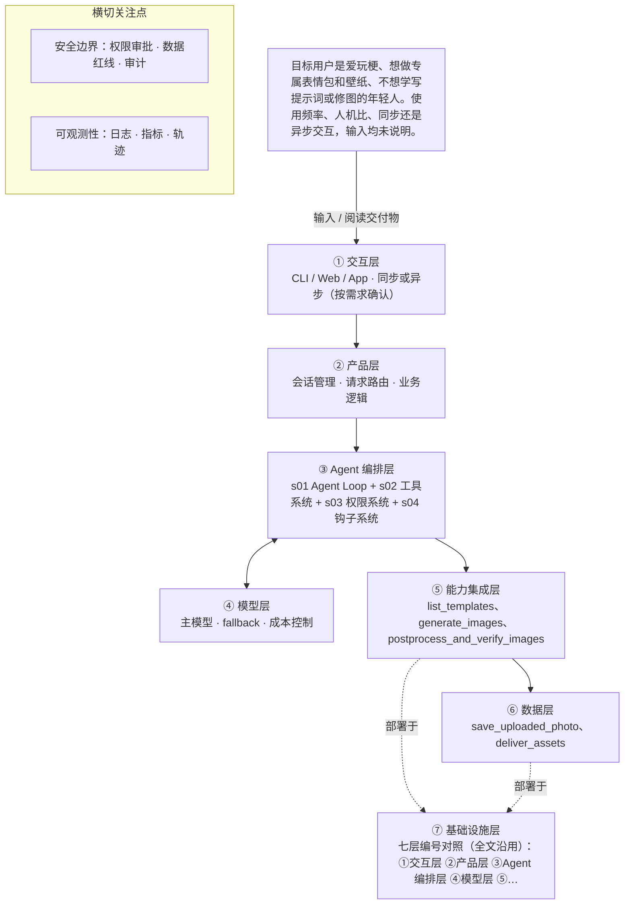

# PRD 推导方案 ——「图个乐」

> 状态：方案待确认（Step 1–4 已完成，Step 5 代码生成需确认后启动）
> 推导引擎：Agent 工坊 · 模型：deepseek-v4-flash

## 产品定位（一句话）

**图个乐**：给爱玩梗、想做专属表情包和壁纸、又不想学写提示词或修图的年轻人：选模板、上传人物照，就能稳定拿到定制的表情包和适配尺寸的壁纸。

## ⚠️ 待确认清单（答不上就是风险点）

**需求问题**：请提出想法的人回答，这几条最要紧。

1. 「图个乐」V1 怎样算做成？请给出可度量指标，例如出图成功率、单次生成时延、成品保存/分享率、模板使用率。
2. 目标用户的使用频率与交互模式是什么？是单人同步等待出图，还是提交后异步通知？一次通常生成几张？
3. 一次完整交付的具体闭环是什么？模板从哪里来、生成几张候选、是否支持多轮微调与重生成、成品如何交付（下载、分享还是存相册）？
4. 需要调用哪些外部系统与数据源？用哪个图像生成模型/API、是否需要人脸检测与对齐、是否需要对象存储与 CDN？
5. 模板与提示词资产如何组织？内置多少套模板、每套模板是否绑定固定提示词与后处理参数、是否需要模板库后台管理？
6. 边界与红线是什么（第 4 节为空）？是否允许上传他人照片或公众人物、涉政涉黄如何拦截、生成内容是否加水印、人脸数据保留多久？
7. 失败怎么办？当模型出图崩坏、人脸不像、超时或审核不通过时的降级策略是什么（重试次数、换模型、退回模板图）？
8. 有哪些硬约束？单张可接受成本与最长等待时间、并发量级、预算上限、可用模型清单分别是什么？

**方案推导时留下的问题**：多是上面问题的细化，也有写给开发者的备注。先答上面的，这里能答的再补。

9. PRD 第 5 节成功指标为空，方案中的 metrics 全为工程侧代理指标，需产品补齐后校准。
10. 第三方图片生成模型与供应商未定，密钥申请、配额、单价、超时阈值均未知。
11. 「稳定」的量化口径未定（成功率阈值、可接受重试次数），直接影响降级策略中「连续失败置为不可用」的阈值设定。
12. 上传照片的格式白名单、大小上限、是否需要人脸检测均未定。
13. 壁纸尺寸规格表（目标机型与分辨率清单）未定，尺寸断言目前无判定依据。
14. 表情包单套张数、单张尺寸、文件格式与文案来源未定。
15. 交付渠道未定（页面展示 / 下载 / 分享链接），影响 deliver_assets 的链接有效期与鉴权设计。
16. 人物照保留期限与删除策略尚未获批，首版按「交付即删」执行，需正式确认。
17. 人工审核由谁承担、时限 SLA、超时是否默认不通过未定；REVIEW_MODE 用内部工单还是外部审核接口也未定。
18. s11 后台任务仍为待确认：单张生成耗时是否可能超过 60 秒，决定是否需要引入异步任务队列。
19. 端形态（Web / 移动端）未定，影响 ①交互层与上传交互方式。
20. 模板库首版模板数量与版权来源未定，模板涉及第三方 IP 时的授权方式未定；PRD 第 4 节「边界与红线」为空，内容审核是否必需目前只是基于肖像类数据的风险推断。
21. 上游待修正项：facts.constraints 状态与内容不一致，应拆为「已明确：出图要稳定」与「待确认：时延 / 并发 / 合规 / 成本 / 模型」；s03 的 destructive_ops 标记与敏感个人信息处理场景不贴合；s04 的「必然需要内容审核」属风险推断，应列入待确认；s15 的放弃理由与 s03、s04 必选结论相互矛盾，需重述。

**待确认的组件**：要不要用，取决于后面这个问题。

22. 【组件 s11 后台任务】是否有耗时几分钟以上的慢操作需要不阻塞主流程？

## Step 1 · 需求拆解（提取硬事实）

| 维度 | 结论 | 状态 | 出处 |
|---|---|---|---|
| 目标 | 让不会写提示词、不会修图的年轻人，通过「选模板 + 上传人物照」稳定产出专属表情包与适配尺寸壁纸，绕开通用 AI 门槛高、出图不稳、缺少后处理这三个问题。可量化的成功标准尚未填写（第 5 节「成功指标」为空）。 | 明确 | 给爱玩梗、想做专属表情包和壁纸、又不想学写提示词或修图的年轻人用，解决通用 AI 门槛高、出图不稳、也没有后处理的问题——选模板、上传人物照，就能稳定做出定制表情包和适配尺寸的壁纸。 |
| 用户 | 目标用户是爱玩梗、想做专属表情包和壁纸、不想学写提示词或修图的年轻人。使用频率、人机比、同步还是异步交互，输入均未说明。 | 明确 | 给爱玩梗、想做专属表情包和壁纸、又不想学写提示词或修图的年轻人用 |
| 核心闭环 | 选模板 → 上传人物照 → 生成定制表情包/壁纸 → 后处理（修图、适配尺寸）→ 交付成品图。是否支持多轮调整与重新生成、成品通过什么渠道交付，输入未说明。 | 明确 | 选模板、上传人物照，就能稳定做出定制表情包和适配尺寸的壁纸。／也没有后处理的问题 |
| 交付物 | 图片类交付物：定制表情包图与按目标尺寸适配的壁纸图。具体文件格式、单次生成张数、分辨率与尺寸清单未说明。 | 明确 | 就能稳定做出定制表情包和适配尺寸的壁纸 |
| 边界 | （空） | 待确认 |  |
| 约束 | 输入中唯一可提取的约束是「出图要稳定」，即针对通用 AI 出图不稳的痛点；时延、并发、合规、成本、可用模型均未给出。 | 待确认 | 解决通用 AI 门槛高、出图不稳、也没有后处理的问题 |

## Step 2 · 领域建模（映射 Harness 五要素）

| 要素 | 内容 |
|---|---|
| **工具** | 调用图片生成模型服务，以「选中的模板 + 用户上传的人物照」作为输入，产出定制表情包图与壁纸图（具体模型与供应商待确认）。；提供模板库的读取接口，按模板标识返回可选的表情包和壁纸模板清单，供用户点选。；接收并保存用户上传的人物照片文件，并在进入生成前完成解码与可用性检查（支持格式与大小上限待确认）。；图片后处理工具：对生成结果执行裁剪、缩放、尺寸适配，输出符合目标壁纸分辨率的成品图（尺寸清单待确认）。；成品图的存储与交付能力，把表情包与壁纸文件交回给用户（交付渠道与文件格式待确认）。 |
| **知识** | 模板库本身承载领域知识：每个模板需携带表情包或壁纸的文案、构图、风格取向，用于替代用户手写提示词。；模板到模型参数的映射规则：把模板标识翻译为可执行的提示词与生成参数，从而解决「门槛高、出图不稳」。；目标设备的壁纸尺寸规格表，用于驱动后处理的适配动作（具体机型与分辨率清单待确认）。；用户人物照的准入规则，例如人脸是否清晰、构图是否可用；输入未说明，待确认。；表情包的常规规格知识，例如单套张数、单张尺寸、文案风格；输入未说明，待确认。 |
| **观察** | 生成结果的模板符合度校验：检查产物是否包含模板要求的构图与文案元素（判定标准待确认）。；后处理输出图的尺寸断言：校验成品图分辨率等于目标壁纸尺寸，不等则判为失败。；上传照片的读取校验：确认文件被成功解码且照片内容可用（是否需要人脸检测待确认）。；生成任务日志：记录每次的模板、参数、输入与失败原因，用于定位「出图不稳」的具体环节。；「稳定」的量化口径，例如同输入多次生成的一致率与成功率阈值；输入未给出，待确认。 |
| **行动** | 在 Web 或移动端界面上让用户完成「选模板 + 上传人物照」两步操作（端形态待确认）。；以接口调用方式把生成任务提交给图片生成模型服务（同步还是异步待确认）。；以服务端脚本或命令行方式对生成结果执行批量后处理，完成裁剪与壁纸尺寸适配。；生成与后处理完成后，把成品图以文件下载或页面展示的形式交付给用户（交付形式待确认）。 |
| **权限** | 默认拒绝：用户上传的人物照属敏感个人数据，不得用于模板库建设、模型训练或对外分享，仅限本次生成任务内使用。；需要审批：人物照的保留期限与删除策略须先确定并获批准后才能上线（输入未给出策略，待确认）。；需要审批：接入会产生费用或涉及数据外发的第三方图片生成接口前，须走审批。；默认拒绝：生成结果涉及他人肖像、公众人物或版权模板时不得直接对外发布，须经人工审核。；默认拒绝：未经用户明示同意，不得把其生成结果用作案例展示或公开传播。 |

## Step 3 · 组件选型（宁可少选）

| 组件 | 选否 | 理由 | 参考 |
|---|---|---|---|
| s01 Agent Loop | ✅ 必选 | 一切基础：循环 + 工具（一切基础，恒选） | s01_agent_loop/README.md |
| s02 工具系统 | ✅ 必选 | 需要调用外部系统/API/数据源（一切基础，恒选） | s02_tool_use/README.md |
| s03 权限系统 | ✅ 必选 | 产品闭环必然要求用户上传人物照并基于人脸生成图片，属于处理肖像类敏感个人信息。 | s03_permission/README.md |
| s04 钩子系统 | ✅ 必选 | 上传真人照片生成并分发图片，必然需要内容审核/拦截与合规留痕，而 PRD 第 4 节「边界与红线」尚为空白，需补齐。 | s04_hooks/README.md |
| s05 任务规划 | ❌ 放弃 | 单次交付是一次模板化出图，用户不需要 Agent 先列计划再逐步推进、汇报进度。 | s05_todo_write/README.md |
| s06 子 Agent | ❌ 放弃 | 闭环是单张/单组图片生成，不存在上下文爆炸或需要并行探索的子任务。 | s06_subagent/README.md |
| s07 技能加载 | ❌ 放弃 | 需要的是内置模板与固定提示词资产，不是庞大、需按需加载的领域知识库。 | s07_skill_loading/README.md |
| s08 上下文压缩 | ❌ 放弃 | 输入描述的是一次选模板、传照片、出图的短会话，未提及长会话或大量工具输出。 | s08_context_compact/README.md |
| s09 记忆系统 | ❌ 放弃 | 输入只描述单次出图闭环，未提及跨会话记住用户偏好或历史作品。 | s09_memory/README.md |
| s10 任务系统 | ❌ 放弃 | 一次出图即交付，输入未提及目标持久化或断点续跑。 | s10_task_system/README.md |
| s11 后台任务 | ❓ 待确认 | 输入未说明：是否有耗时几分钟以上的慢操作需要不阻塞主流程？ | s11_background_tasks/README.md |
| s12 定时调度 | ❌ 放弃 | 产品由用户主动触发出图，输入未提及任何定时自动触发。 | s12_cron_scheduler/README.md |
| s13 Agent 团队 | ❌ 放弃 | 输入未提及多任务并行或多 Agent 团队、独立工作区。 | s13_agent_teams/README.md |
| s14 MCP 插件 | ❌ 放弃 | 输入只提到图像生成能力，未提及接入 MCP、第三方插件等外部工具生态。 | s14_mcp_plugin/README.md |
| s15 集成 Harness | ❌ 放弃 | 可选组件不足 3 个，直接在 loop 里挂接即可 | s15_integrated_harness/README.md |
| s16 工作流运行时 | ❌ 放弃 | 原文只描述产品体验（选模板、上传人物照就能出图），并未写成带固定阶段序列的流程规格。 | s16_workflow_runtime/README.md |
| s17 目标闭环 | ❌ 放弃 | 出图成功即交付，输入未提及需要独立的完成度评估器来判断何时算完成。 | s17_goal_loop/README.md |

特征判定依据：

- `destructive_ops` = yes：产品闭环必然要求用户上传人物照并基于人脸生成图片，属于处理肖像类敏感个人信息。
- `audit_needed` = yes：上传真人照片生成并分发图片，必然需要内容审核/拦截与合规留痕，而 PRD 第 4 节「边界与红线」尚为空白，需补齐。
- `multi_step` = no：单次交付是一次模板化出图，用户不需要 Agent 先列计划再逐步推进、汇报进度。
- `context_heavy` = no：闭环是单张/单组图片生成，不存在上下文爆炸或需要并行探索的子任务。
- `large_knowledge` = no：需要的是内置模板与固定提示词资产，不是庞大、需按需加载的领域知识库。
- `long_sessions` = no：输入描述的是一次选模板、传照片、出图的短会话，未提及长会话或大量工具输出。
- `cross_session_memory` = no：输入只描述单次出图闭环，未提及跨会话记住用户偏好或历史作品。
- `persistent_goals` = no：一次出图即交付，输入未提及目标持久化或断点续跑。
- `slow_operations` = unknown：输入没有给出单次出图耗时与等待方式，若生成需数分钟以上则涉及异步不阻塞主流程。
- `scheduled` = no：产品由用户主动触发出图，输入未提及任何定时自动触发。
- `parallel_isolated` = no：输入未提及多任务并行或多 Agent 团队、独立工作区。
- `external_ecosystem` = no：输入只提到图像生成能力，未提及接入 MCP、第三方插件等外部工具生态。
- `fixed_orchestration` = no：原文只描述产品体验（选模板、上传人物照就能出图），并未写成带固定阶段序列的流程规格。
- `auto_completion` = no：出图成功即交付，输入未提及需要独立的完成度评估器来判断何时算完成。

## Step 4 · 架构设计

### 分层架构图（7 层 + 数据流）



| 层 | 名称 | 回答的问题 | 落地锚点 |
|---|---|---|---|
| ① | 交互层 | 谁在用、怎么用？ | CLI / Web / App / API；同步或异步；人机比 |
| ② | 产品层 | 产品外壳是什么？ | 会话管理、请求路由、账户、业务逻辑 |
| ③ | Agent 编排层 | Harness 如何运转？ | loop、工具分发、hooks、权限、记忆、任务、技能、压缩、子 agent / 团队、目标闭环 |
| ④ | 模型层 | 智能从哪来？ | 主模型、辅助模型、路由、fallback、成本 |
| ⑤ | 能力集成层 | 如何触达外部世界？ | 内部工具、MCP server、知识库、第三方 API |
| ⑥ | 数据层 | 什么需要持久化？ | 记忆、任务、会话历史、轨迹数据、日志指标 |
| ⑦ | 基础设施层 | 如何部署运行？ | 单进程 / 服务 / 团队、沙箱、队列、调度、监控 |

### 工具清单

| 工具 | 输入 | 输出 | 副作用 | 权限 | 归属层 |
|---|---|---|---|---|---|
| `list_templates` | 品类（表情包 / 壁纸）、可选的风格标签、分页游标 | 模板清单：每项含 template_id、名称、预览图地址、适用品类、默认目标尺寸标识 | 只读模板库，不写入任何数据 | allow | ⑤ |
| `resolve_template_params` | template_id、用户可选参数（文案、张数）、目标壁纸尺寸标识 | 可直接执行的提示词、模型生成参数、目标尺寸清单（宽高与格式）、映射失败时返回错误码 | 纯计算，无外部副作用，不读取用户照片；消费「模板到模型参数映射规则」与「壁纸尺寸规格表」两条知识 | allow | ③ |
| `save_uploaded_photo` | 用户上传的文件流、声明的内容类型、文件大小 | 照片引用 id、解码结果、可用性检查结论（通过 / 拒绝及原因） | 落盘到受控目录并写任务记录；产物按任务 id 隔离，仅本任务可读；解码失败时不保留原文件 | ask | ⑥ |
| `generate_images` | 提示词与模型参数、照片引用 id、template_id | 生成图列表，含每张的成功状态与失败原因 | 调用第三方图片生成服务，产生费用并将人物照外发给服务方；每次调用写调用日志 | ask | ⑤ |
| `postprocess_and_verify_images` | 生成图引用、目标尺寸清单（来自 resolve_template_params） | 裁剪缩放后的成品图引用，以及每张的尺寸断言结果（通过 / 失败） | 写成品文件；对每张断言分辨率等于目标尺寸，不等即判该张失败并触发回退重试，不允许静默通过；消费「壁纸尺寸规格表」知识 | allow | ⑤ |
| `request_human_review` | 任务 id、成品图引用、触发原因（他人肖像 / 公众人物 / 版权模板 / 用户申诉） | 审核工单号、审核结论（通过 / 驳回 / 待审） | 挂起交付直到审核结论返回，并写审核留痕；对应权限要素第 4 条「不得直接对外发布」的执行主体 | allow | ③ |
| `deliver_assets` | 成品图引用、交付形式（页面展示 / 下载）、审核状态令牌 | 对外可见的图片或下载链接、交付回执 | 生成对外可访问链接；未持有审核通过令牌时直接拒绝交付并记审计日志 | ask | ⑥ |

### 系统提示词草案

```
你是「图个乐」的出图助手，服务爱玩梗、想做专属表情包和壁纸、不会写提示词也不会修图的年轻人。

职责：把用户「选模板 + 上传人物照」翻译成一次稳定的出图任务——解析模板参数、调用生成、后处理适配尺寸、校验后交付。

规则：
1. 只用模板库内的模板，不得自行编造模板或提示词；模板缺失就如实告知用户换一个。
2. 用户上传的人物照只用于本次任务，不得用于模板建设、模型训练、案例展示或对外分享。
3. 每张成品必须通过尺寸断言才算完成；未通过就重试或如实报失败，绝不许把未校验的图交付。
4. 涉及他人肖像、公众人物或版权模板，先发起人工审核，未通过不得交付。
5. 没有依据的信息（费用、模型、尺寸清单）一律说不知道并记入待确认，不许编造。

工具说明：list_templates 列模板；resolve_template_params 把模板转成提示词与目标尺寸；save_uploaded_photo 保存并检查照片；generate_images 调生成服务；postprocess_and_verify_images 裁剪适配并断言尺寸；request_human_review 发起人工审核；deliver_assets 校验审核令牌后交付。

知识目录：模板库（文案 / 构图 / 风格）、模板到模型参数映射规则、壁纸尺寸规格表、照片准入规则（待确认）、表情包规格（待确认）。
```

### 上下文与记忆策略

会话内只维护任务状态机：已选 template_id、照片引用 id 与文件哈希、resolve_template_params 产出的生成参数与目标尺寸清单、重试次数与失败原因、审核工单号与状态、交付回执。原图二进制与完整提示词不进上下文，只放引用 id 与摘要，以此控制上下文体积（对应放弃上下文压缩组件）。单个任务结束即销毁上下文；用户在同一会话内换模板则重开任务，不复用上一个模板的参数。跨会话不做持久化记忆（对应放弃记忆系统），仅把任务记录与审核留痕落库用于排障与合规留痕，按日志保留期管理；人物照按待确认的保留策略处理，首版默认交付完成即删除。

### 安全边界与降级策略

- 工具失败：generate_images 返回错误码或空图 → Agent Loop 以同一模板同一参数最多重试 2 次，仍失败则告知用户本次未出图并释放任务；连续失败超阈值时由权限系统把 generate_images 置为不可用，禁止静默切换到未审批的其他模型（默认拒绝）。
- 模型幻觉：成品与模板要求的文案、构图不符或出现用户照片里没有的元素 → 由 postprocess_and_verify_images 的断言拦截，判该张失败并回退重试；首版只强制尺寸与文件有效性断言，模板符合度判定标准未定，由人工审核兜底。
- 超时：第三方生成调用超过阈值 → Agent Loop 强制结束本次调用，任务置为「已超时」并向用户返回可重试提示，不阻塞等待；阈值待确认，建议单张 120 秒。
- 越权（交付）：未通过人工审核即请求交付 → 权限系统校验审核令牌，deliver_assets 直接拒绝并记审计日志；审核由人工审核方在审核工单内判定，审核方与时限待确认，超时未审按不通过处理（默认拒绝）。
- 越权（数据越界）：照片或成品被跨任务读取、被挪作模板建设 → 权限系统按任务 id 做作用域隔离，跨任务读取一律 deny 并告警；命中即终止任务并留痕。
- 上传异常：文件无法解码、格式不在白名单或超过大小上限 → save_uploaded_photo 拒绝并返回明确原因，不落盘保留原始文件，不进入生成环节。
- 保留策略缺位：人物照保留期限尚未获批 → 钩子系统在交付完成后按最短保留（会话结束即删）执行，策略正式批准后再调整，删除动作写日志以便核验。
- 红线内容：用户要求生成公众人物或他人肖像 → request_human_review 挂起交付，未取得通过结论前 deliver_assets 一律拒绝。

### 可观测性

- 日志：任务级结构化日志：task_id、template_id、照片引用 id（脱敏）、生成调用次数、重试原因、命中的降级分支、最终状态；工具级日志：工具名、入参摘要、耗时、成败、错误码，与 task_id 关联；审核事件日志：工单号、触发原因、审核结论、处理时长；文件生命周期日志：照片与成品的哈希、大小、写入时间与删除时间，用于核验保留策略是否真的执行
- 指标：生成任务成功率 = 完成交付任务数 / 提交任务数（来源任务日志，可采集；PRD 第 5 节为空，此项为工程侧代理指标，待 PRD 补齐后校准）；后处理尺寸断言通过率（来源工具日志，可采集，口径明确：断言通过张数 / 后处理总张数）；端到端时延 P50 / P95，口径为任务提交到交付回执（来源任务日志时间戳，可采集）；人工审核挂起率与平均审核时长（来源审核工单，可采集，依赖审核流程落地）；不采集「同输入多次生成一致率」：需重复生成同一输入，调用成本翻倍且首版无预算依据，待 PRD 明确口径与预算后再定是否按周抽样统计
- 轨迹：每个任务分配一个 trace_id，按步骤顺序记录工具名、入参与出参摘要（照片与成品只记引用 id 与哈希，不记原图）、耗时、成败与命中的降级分支，与任务日志同源落盘，保留期与日志一致。

### 技术栈与部署形态

七层编号对照（全文沿用）：①交互层 ②产品层 ③Agent 编排层 ④模型层 ⑤能力集成层 ⑥数据层 ⑦基础设施层。

部署形态：第一版为单进程服务。语言 Python 3.11，Web 框架 FastAPI，入口 app/main.py，依赖清单 requirements.txt（fastapi、uvicorn、httpx、pillow、pydantic、pytest）。一条命令启动：uvicorn app.main:app --host 0.0.0.0 --port 8000（另提供 make run 等价封装）。模型来源为第三方图片生成 API，经 httpx 在 ⑤ 能力集成层接入，具体供应商待确认。

配置与密钥外置：仓库只提交 .env.example，真实 .env 进 .gitignore；配置一律由环境变量注入，代码不硬编码、不打印密钥。变量清单：GEN_PROVIDER_BASE_URL、GEN_PROVIDER_API_KEY、GEN_PROVIDER_MODEL、GEN_REQUEST_TIMEOUT_SECONDS、GEN_MAX_CONCURRENCY、TEMPLATE_LIBRARY_PATH（模板库 JSON）、WALLPAPER_SPEC_PATH（尺寸规格表 YAML）、UPLOAD_MAX_MB、UPLOAD_ALLOWED_FORMATS、PHOTO_RETENTION_HOURS、REVIEW_MODE（internal / webhook）、REVIEW_WEBHOOK_URL、STORAGE_ROOT、TASK_DB_URL（首版 sqlite）、LOG_LEVEL。密钥管理：GEN_PROVIDER_API_KEY 只从环境变量读取，不落库不写日志，轮换方式待确认，上线前需接入正式密钥管理服务。

安装与接入步骤：①pip install -r requirements.txt；②复制 .env.example 为 .env 并填入密钥与路径；③把模板库 JSON 与尺寸规格表 YAML 放到配置路径；④跑 scripts/check_provider.py 用公开示例图做连通性与配额自检；⑤启动服务并访问健康检查接口 /healthz。

人工审核对接：首版 REVIEW_MODE=internal，审核工单写 sqlite 表 review_ticket，由内部审核页处理；REVIEW_MODE=webhook 时把工单推送到外部审核系统并回写结论。deliver_assets 只认工单状态。审核方与 SLA 待确认。

单机上限：上传图、成品图、日志落 STORAGE_ROOT 本地磁盘，任务与工单存 sqlite；uvicorn 单 worker，生成调用并发上限由 GEN_MAX_CONCURRENCY 控制（默认 2）。磁盘容量、日任务量与并发上限的具体数值待确认。

测试设计（对应「可测试」）：框架 pytest，目录分 tests/unit、tests/integration、tests/security。单元测试覆盖 Agent Loop 的工具分派（每个工具名映射到正确工具、未知工具名拒绝）、resolve_template_params 的模板到参数映射、尺寸断言逻辑、各工具入参校验；集成测试跑一条 happy path（选模板 → 上传 → 生成 → 后处理 → 交付）。外部依赖 mock：把生成服务抽象为 ProviderClient 接口，测试用 FakeProvider 返回固定 fixture 图、指定错误码或注入超时；后处理不对 mock 结果造假，用 Pillow 对真实 fixture 跑真实裁剪与断言。安全与降级测试：security_and_degradation 的 8 条路径各写至少 1 个用例——重试耗尽、调用超时、不符模板的图不过断言、无审核令牌交付被拒、跨任务读照片被拒、非法上传被拒、保留期到点删除、公众人物挂审。模板库与尺寸规格表在测试中使用专用 fixture 配置，不读生产配置。

## 验收标准对照（可落地 vs demo）

| 标准 | 要求 | 本方案的对应设计 |
|---|---|---|
| 可运行 | 一条命令能起，配置与密钥外置（.env / config） | 七层编号对照（全文沿用）：①交互层 ②产品层 ③Agent 编排层 ④模型层 ⑤能力集成层 ⑥数据层 ⑦基础设施层 |
| 可容错 | 工具失败、模型幻觉、超时、越权都有明确降级路径 | 工具失败：generate_images 返回错误码或空图 → Agent Loop 以同一模板同一参数最多重试 2 次，仍失败则告知用户本次未出图并释放任务；连续失败超阈值时由权限系统把 generate_images 置为不可用，禁止静默切换到未审批的其他模型（默认拒绝）。；模型幻觉：成品与模板要求的文案、构图不符或出现用户照片里没有的元素 → 由 postprocess_and_verify_images 的断言拦截，判该张失败并回退重试；首版只强制尺寸与文件有效性断言，模板符合度判定标准未定，由人工审核兜底。；超时：第三方生成调用超过阈值 → Agent Loop 强制结束本次调用，任务置为「已超时」并向用户返回可重试提示，不阻塞等待；阈值待确认，建议单张 120 秒。 |
| 可观测 | 有日志、有指标、有轨迹数据 | 任务级结构化日志：task_id、template_id、照片引用 id（脱敏）、生成调用次数、重试原因、命中的降级分支、最终状态；工具级日志：工具名、入参摘要、耗时、成败、错误码，与 task_id 关联；生成任务成功率 = 完成交付任务数 / 提交任务数（来源任务日志，可采集；PRD 第 5 节为空，此项为工程侧代理指标，待 PRD 补齐后校准）；后处理尺寸断言通过率（来源工具日志，可采集，口径明确：断言通过张数 / 后处理总张数） |
| 可测试 | 核心循环与工具分派有单测，权限与安全有边界测试 | Step 5 骨架层需附核心循环与权限边界的单测 |
| 可部署 | 有明确的部署形态（单进程 / 服务 / 团队）与启动文档 | 见上文「技术栈与部署形态」 |
| 可度量 | 有对齐 PRD 的成功指标，并能采集 | 生成任务成功率 = 完成交付任务数 / 提交任务数（来源任务日志，可采集；PRD 第 5 节为空，此项为工程侧代理指标，待 PRD 补齐后校准）；后处理尺寸断言通过率（来源工具日志，可采集，口径明确：断言通过张数 / 后处理总张数）；端到端时延 P50 / P95，口径为任务提交到交付回执（来源任务日志时间戳，可采集）；人工审核挂起率与平均审核时长（来源审核工单，可采集，依赖审核流程落地）；不采集「同输入多次生成一致率」：需重复生成同一输入，调用成本翻倍且首版无预算依据，待 PRD 明确口径与预算后再定是否按周抽样统计 |

## 独立审稿意见

- 结论：✅ 通过（80 / 100），设计稿共 2 版
- 总评：整体质量较高：工具清单与服务端降级、可观测、可测试、可部署四项均有具体可执行设计，且方案主动在 open_questions 中披露了多处上游缺陷。主要问题集中在三处：一是「可度量」因 PRD 第 5 节为空而无法与产品成功指标对齐，核心的「出图稳定」也没有可采集口径；二是权限与内容审核相关条目在原始输入中无出处，属于风险推断却部分写成「必然」，与 facts 逐条标源的做法不一致；三是 s03、s04、s15 的选型特征与理由存在自认但未修正的证据链偏差。以上均为可修订项，无阻断性编造，故判定通过但分数不高。
- [medium] facts.constraints：value 中写「唯一可提取的约束是出图要稳定」，这本身在原始输入中有直接出处、属于明确项，但 status 标为「待确认」，且 source 引用的是痛点句而非约束句。状态与内容自相矛盾，方案虽在 open_questions 末条自认此点，但正文未修正，审稿人无法据此判断该约束是否可依赖。建议拆为「已明确：出图稳定」与「待确认：时延/并发/合规/成本/模型」。
- [medium] design.observability：「可度量」这条验收标准只做到一半：PRD 第 5 节成功指标为空，方案给出的成功率、断言通过率、时延、审核挂起率全部是工程侧代理指标，没有任何一条能与 PRD 成功指标对齐（因为不存在）。更关键的是，PRD 的核心痛点是「出图不稳」，而最贴近该痛点的「同输入多次生成一致率」被以成本为由排除，导致核心价值主张在首版无法被度量。方案已列入待确认，但需明确：PRD 补齐指标前，本项验收不成立。
- [medium] components.s03：权限系统判为必选，理由是人脸属敏感个人信息，但 feature 字段填的是 destructive_ops（破坏性操作），与「处理肖像类敏感数据」这一实际依据不对应。选型理由与特征证据链不一致，属于方案自己在 open_questions 中已列出但未修正的问题。
- [medium] components.s04：钩子系统判为必选，理由写「必然需要内容审核/拦截与合规留痕」，但 PRD 第 4 节「边界与红线」为空，原始输入中没有任何内容审核、版权、肖像授权的表述。这是基于场景的风险推断而非输入事实，却被写成「必然」。方案在 open_questions 中承认了该推断，但 components 正文未加注，违反无编造要求。
- [medium] elements.permissions：五条权限规则（照片不得用于训练/模板建设、保留期限需审批、第三方接口需审批、涉他人肖像不得直接发布、不得作案例展示）在原始输入中全部无出处，PRD 完全没有安全与合规章节。这些作为工程默认是合理的，但未标注来源为「合理默认/风险推断」，与 facts 中逐条标注出处的做法不一致，读者会误以为来自 PRD。
- [medium] components.s15：集成 Harness 的放弃理由是「可选组件不足 3 个」，但同一张表里 s03、s04 均为必选并需要接入外部审核与权限校验，s11 仍为待确认；该理由与整表结论在表述上互相矛盾，方案自己也已列入 open_questions 而未重述。
- [low] elements.tools 与 design.tool_list：五要素的 tools 只列了 5 项，而 design.tool_list 有 7 个工具：resolve_template_params 与 request_human_review 没有在 tools 要素中出现，只能靠 knowledge 第 2 条和 permissions 第 4 条间接支撑。虽然能推出对应关系（7 个工具均可回溯到某一要素），但需要审稿人自行拼接，建议在 tools 要素补齐或在 tool_list 中标注每个工具对应的要素编号。
- [low] design.tool_list.layer：layer 字段使用 ①-⑦ 编号，但其定义（①交互层…⑦基础设施层）只出现在 tech_stack_and_deployment 段落，工具表中无说明；且全部工具只覆盖 ③⑤⑥，④模型层无任何工具落位，而 generate_images 恰恰调用模型层。编号语义与落位需要澄清。
- [low] design.security_and_degradation（模型幻觉）：幻觉降级路径实际只有尺寸与文件有效性断言在起作用，模板符合度判定标准未定、由人工审核兜底。也就是说「生成了一张尺寸正确但内容完全不符模板的图」目前拦不住，会被当作合格品交付。方案已诚实标注，但该条降级的名义覆盖大于实际覆盖，需在验收时明确这是已知缺口而非已解决。
- [low] facts.core_loop / facts.deliverable：两项 status 均标「明确」，但 value 内同时写了「是否支持多轮调整与重新生成、交付渠道未说明」「文件格式、张数、分辨率未说明」等未定项，明确与待确认混在同一条里，弱化了待确认清单的可见性。建议把未定部分拆出。

## 本次推导消耗

- 模型调用 2 次，输入 3855 tokens，输出 13569 tokens

## 下一步

回答上面的待确认清单，据此修订方案后，再进入 Step 5 代码生成（骨架 → 硬化 → 产品化）。
